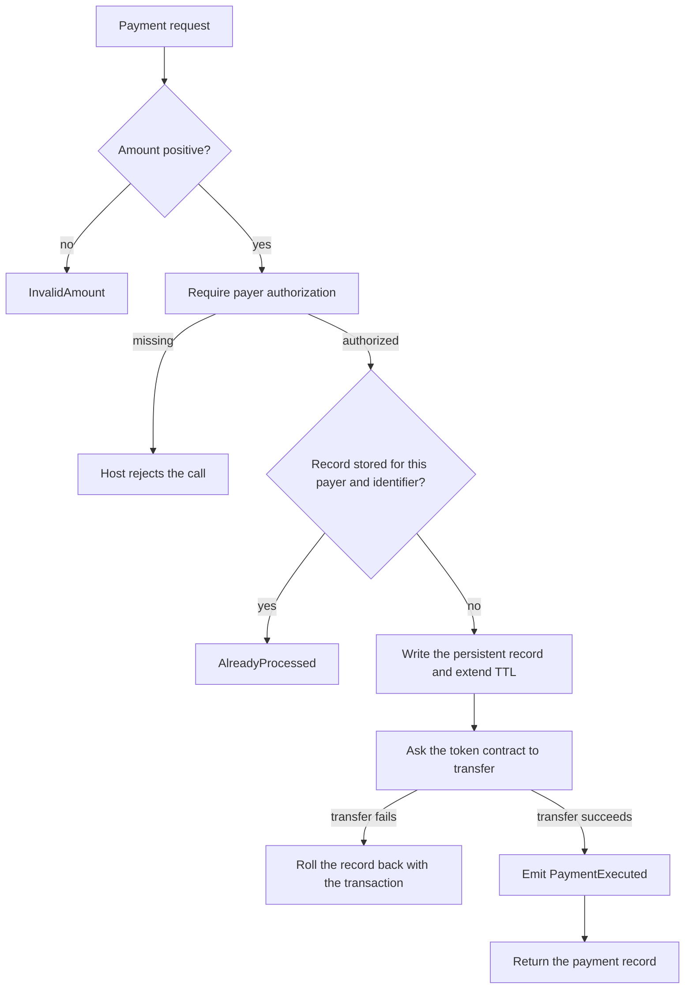

<p align="center">
  
</p>

<p align="center">
  <a href="https://www.rust-lang.org/"></a>
  <a href="https://developers.stellar.org/docs/tools/cli"></a>
  <a href="https://docs.rs/soroban-sdk/30.0.0/soroban_sdk/"></a>
  
</p>

Unica is an idempotent payment contract for Stellar. A payer names a 32-byte payment identifier, and the contract performs that token transfer once.

It is an individual Stellar bootcamp project and an educational prototype. It has not been audited, and it is not a production payment system.

## Contents

- [The problem](#the-problem)
- [Why Stellar](#why-stellar)
- [How Unica works](#how-unica-works)
- [Smart contract API](#smart-contract-api)
- [Security model](#security-model)
- [Getting started](#getting-started)
- [Testing](#testing)
- [Example](#example)
- [Project structure](#project-structure)
- [Limitations](#limitations)
- [References](#references)
- [Author](#author)

## The problem

A business payment is an instruction such as "pay this invoice once." A Stellar transaction is a signed envelope with its own sequence number. Those are different objects, and each one has its own replay rule.

Stellar accepts a source account's transaction only when its sequence number is exactly one greater than the account's current sequence number. After the transaction executes, the account sequence advances to that value, so the same signed envelope cannot be applied again. Horizon reports a repeated submission of that envelope as `DUPLICATE`. Resubmitting the unchanged envelope is the safe retry.

The unsafe retry is a new envelope. A timeout, a lost HTTP response, or `tx_bad_seq` does not prove that the first transaction failed. Horizon's error-handling guide says to check the ledger before rebuilding. A rebuilt transaction, with a new sequence number, is a new transaction. If the original was included as well, both take effect. The guide's own example is a payment button pressed several times: the identical envelopes fail with `tx_bad_seq`, and rebuilding each one with the next sequence number sends the payment more than once.

Unica is the application-level check for that second case. The payer chooses an identifier for the business intent. The contract stores a persistent record of the successful execution and rejects a later call that repeats the same payer and identifier, even when the later call is a valid new Stellar transaction.

Consider a 100 USDC payment. The sender submits it, the network includes it, and the client times out before it sees the result. The operator assumes the payment failed and submits a second transaction for the same 100 USDC, with the next sequence number. Stellar accepts the second transaction because it is not a replay of the first envelope. The recipient is paid 200 USDC. If both calls go through Unica with the same payer and the same payment identifier, the second call stops with `AlreadyProcessed` and moves no additional funds.

That protection applies only to calls that reach this contract with the same payer and identifier. A transfer submitted directly to the token, or a second Unica call with a new identifier, is outside the record.

## Why Stellar

Stellar already gives this contract the four pieces it uses.

Token contracts, including the Stellar Asset Contract for a classic asset such as USDC, share a token interface. Unica calls `transfer` on the token address the payer supplies. The token moves the funds from the payer to the recipient. Unica does not take a balance of its own.

Soroban authorization lets the contract call `require_auth` on the payer. The host checks that the payer authorized this invocation, including the nested token transfer. The same host also provides replay protection for those authorization entries, which is separate from the payment identifier stored here.

A contract invocation that fails does not commit its writes. Unica relies on that when the token rejects the transfer: the payment record written earlier in the call is discarded with the failed transaction. The test suite checks that outcome.

Persistent contract storage keeps the record after the transaction. Temporary storage would be deleted when its TTL expires, which would make a duplicate look like a new payment. Persistent entries are archived instead, and a later transaction can restore them.

The [Stellar Development Foundation's 2026 strategy](https://stellar.org/foundation/strategy) describes the network as infrastructure for everyday financial services, including payments. That is context for why a payment contract fits the network. It is not an endorsement of Unica.

## How Unica works

`execute_payment` runs the steps below, in this order.



The amount is rejected before authorization, so a zero or negative amount does not ask the payer to sign. Authorization is required before any write. The duplicate check uses the key `(payer, payment_id)` and ignores the recipient, token, and amount. Changing those fields does not open a second payment.

The record is written before the token call. If the transfer fails, Soroban aborts the transaction and the write is not committed. If a later host allowed the token to call back into Unica, the stored record would already be visible to that callback. The current host rejects that re-entry before the inner call runs. See [Re-entrancy](#re-entrancy).

`PaymentExecuted` is published only after `transfer` returns. Its topics are the payer and the payment identifier. The event data is the recipient, token, amount, and ledger timestamp.

## Smart contract API

The contract exposes three functions. Amounts are the token's raw `i128` units. For a Stellar asset with 7 decimal places, 100 USDC is `1_000_000_000`.

### `execute_payment`

```rust
pub fn execute_payment(
    env: Env,
    payer: Address,
    recipient: Address,
    token: Address,
    amount: i128,
    payment_id: BytesN<32>,
) -> PaymentRecord
```

| Parameter | Meaning |
| --- | --- |
| `payer` | Account or contract that funds the transfer and must authorize the call. |
| `recipient` | Account or contract that receives the tokens. The payer may be the recipient. |
| `token` | Token contract. Unica calls its `transfer` function. |
| `amount` | Raw token units. Must be greater than zero. |
| `payment_id` | 32-byte identifier chosen by the caller. Unique for this payer. |

On success the function returns the stored `PaymentRecord`. The ledger timestamp in that record is the ledger close time, not a wall clock from the caller.

| Failure | Result |
| --- | --- |
| `amount <= 0` | `Error::InvalidAmount` (`1`). No authorization and no write. |
| The payer did not authorize this invocation | Host rejection. No Unica error code. |
| This payer already has a record for `payment_id` | `Error::AlreadyProcessed` (`2`). No second transfer. |
| The token contract rejects the transfer | Host rejection. The new record is rolled back. |

A payer-to-self transfer is accepted when the token accepts it. The identifier is still consumed. For a Stellar Asset Contract the balance is unchanged, because the debit and the credit are the same address.

### `get_payment`

```rust
pub fn get_payment(
    env: Env,
    payer: Address,
    payment_id: BytesN<32>,
) -> Option<PaymentRecord>
```

Returns the stored record, or `None` when no live record exists. Reading a live record extends its TTL. The function does not require authorization. An archived record is not `None`: the transaction restores it, or the transaction fails before this function runs.

### `is_processed`

```rust
pub fn is_processed(
    env: Env,
    payer: Address,
    payment_id: BytesN<32>,
) -> bool
```

Returns `true` when a live record exists for this payer and identifier, and extends that record's TTL. Returns `false` when no live record exists. An archived record is not reported as unprocessed. The transaction fails closed until the entry is restored.

### `PaymentRecord`

```rust
pub struct PaymentRecord {
    pub payment_id: BytesN<32>,
    pub payer: Address,
    pub recipient: Address,
    pub token: Address,
    pub amount: i128,
    pub timestamp: u64,
}
```

The storage key is `DataKey::Payment(payer, payment_id)`. The identifier is scoped to the payer. Another payer may use the same 32 bytes for a different payment. The same payer may not reuse them for a different recipient, token, or amount.

### Errors

```rust
pub enum Error {
    InvalidAmount = 1,
    AlreadyProcessed = 2,
}
```

Both abort the transaction. Authorization failures and token failures are host errors, not values of this enum.

### TTL

The contract counts 17,280 ledgers as one day, the figure for a 5-second ledger close used in the [storage strategies guide](https://developers.stellar.org/docs/build/guides/storage/storage-strategies).

| Entry | Extend to | Extend when remaining TTL is below |
| --- | --- | --- |
| Payment record | 120 days, `2,073,600` ledgers | About 113 days |
| Contract instance and code | 30 days, `518,400` ledgers | About 29 days |

`extend_ttl` does not restore an archived entry, and it does not make the record permanent. The network also caps how far a TTL can be extended. A successful read or write refreshes a live entry. A rejected duplicate panics before the extension, so it does not refresh the existing record.

## Security model

Unica is an educational prototype. These notes describe the checks in this repository. They are not an audit, and they are not a claim that the contract is safe to custody funds or to run as production infrastructure.

### Payer authorization

`execute_payment` calls `payer.require_auth()` before it writes or calls the token. The host requires the payer to authorize this function and the nested `transfer`. A call with no payer authorization, or with a signature from a different address, is rejected by the host. The success-path tests build that authorization tree explicitly and compare it with `env.auths()`. They do not rely on `mock_all_auths` alone.

Reads are public. `get_payment` and `is_processed` do not require authorization.

### Duplicate prevention

The persistent key is the payer plus the identifier. The second successful execution is the one that must be prevented. A second call is rejected when that key exists, including when the amount, recipient, or token differs. Two payers do not share a key. Two identifiers from one payer are two payments.

### Atomic execution

The record is written, then the token is called. A token rejection aborts the invocation. The tests check that the failed attempt leaves no record, does not mark the identifier processed, and does not emit `PaymentExecuted`. The same identifier can be used after the payer has enough balance.

### Persistent storage

Payment records use persistent storage. Temporary storage is deleted at expiry, so it cannot support a durable duplicate check. Persistent and instance entries are archived when their TTL reaches zero. The [state archival](https://developers.stellar.org/docs/learn/fundamentals/contract-development/storage/state-archival) guide describes the usual restore path: the transaction that next accesses the entry includes the restore, often added during simulation. A transaction that omits it fails before the contract runs.

The local test host restores an expired persistent entry automatically. That test shows the restored record is still a duplicate. It does not reproduce a transaction that fails closed because the restore footprint was omitted.

### Re-entrancy

The Soroban host used by soroban-sdk 30 rejects a cross-contract re-entry into Unica while `transfer` is still on the stack. The test token records that rejection as `Context` / `InvalidAction` and then returns success. The outer call still stores one record and emits one event. The inner `AlreadyProcessed` check is not reached, because the host stops the callback first.

The write-before-transfer order remains in the contract for a host that later permits re-entry, and because a failed transfer must roll the write back. This SDK does not provide a test switch that allows the callback to enter the contract.

### Token trust

Unica treats a returned `transfer` as a completed movement of `amount` from `payer` to `recipient`. The official [token interface](https://developers.stellar.org/docs/tokens/token-interface) is what a compatible token implements. A token can ignore that interface and return success without moving funds. The contract cannot detect that. Callers should pass a token they trust, such as the Stellar Asset Contract for the asset they intend to move.

The token's `transfer` signature takes a `MuxedAddress` recipient. The SDK client accepts the `Address` Unica stores and passes it as a non-muxed recipient.

### Custody

Unica never holds the tokens. The token contract debits the payer and credits the recipient. There is no admin, no upgrade function, and no recovery key in this contract.

## Getting started

Verified on this workspace with rustc 1.100.0, cargo 1.100.0, Stellar CLI 30.0.1, and soroban-sdk 30.0.0. The package declares `rust-version = "1.91"`. The [setup guide](https://developers.stellar.org/docs/build/smart-contracts/getting-started/setup) requires Rust 1.84.0 or newer for the `wasm32v1-none` target.

Install Rust with [rustup](https://rustup.rs/), then install the [Stellar CLI](https://developers.stellar.org/docs/tools/cli/install-cli):

```sh
curl --proto '=https' --tlsv1.2 -sSf https://sh.rustup.rs | sh
curl -fsSL https://github.com/stellar/stellar-cli/raw/main/install.sh | sh
```

Clone the repository and enter it. `rust-toolchain.toml` selects the stable channel, rustfmt, clippy, and the `wasm32v1-none` target.

```sh
git clone https://github.com/Ansllxs/unica.git
cd unica
rustup target add wasm32v1-none
rustc --version
stellar version
```

`rustup target add` is the command from the setup guide. With this `rust-toolchain.toml`, rustup also installs that target for the selected toolchain when the project is used.

Build the contract and run the tests from the workspace root:

```sh
stellar contract build
cargo test --workspace
```

`stellar contract build` writes the optimized WASM to:

```text
target/wasm32v1-none/release/unica.wasm
```

The verified build is 5,014 bytes and its SHA-256 is `a7db7ed7346ef242104622a0b6da6612a49d0bbca119498585d6abc0aa00c8d3`. It exports `execute_payment`, `get_payment`, and `is_processed`.

`contracts/unica/Makefile` wraps the same two commands: `make -C contracts/unica build` and `make -C contracts/unica test`.

These commands compile and test locally. They do not deploy the contract.

## Testing

The workspace suite has 30 tests: 30 passed, 0 failed, 0 ignored.

| Group | Tests | What they cover |
| --- | --- | --- |
| Successful payments | 5 | Amount, balances, stored record, processed flag, and `PaymentExecuted`. |
| Duplicate prevention | 7 | Same identifier, changed amount, recipient, or token, distinct identifiers, and distinct payers. |
| Authorization and validation | 6 | Missing authorization, wrong signer, the recorded auth tree, zero, negative, and insufficient balance. |
| Atomicity | 6 | No record, flag, or success event after a failed transfer. The identifier can be reused. Absent and existing records stay intact. |
| Storage and edge cases | 6 | Persistent TTL, threshold behavior, archival in the test host, payer-to-self, and a re-entrant token callback. |

Run the suite, the lints, and the WASM build from the repository root:

```sh
cargo fmt --all --check
cargo test --workspace
cargo check --workspace --all-targets
cargo clippy --workspace --all-targets -- -D warnings
stellar contract build
```

## Example

The snippet below is illustrative. The addresses are placeholders, and this is not a transaction submitted to a network. The same success-then-duplicate sequence is what the unit tests execute against a local Stellar Asset Contract.

```rust
let payment_id = BytesN::from_array(&env, &[7; 32]);
let amount: i128 = 1_000_000_000; // 100 units at 7 decimal places

let record = client.execute_payment(&payer, &recipient, &token, &amount, &payment_id);

// record.payer, record.recipient, record.token, and record.payment_id
// match the arguments. record.amount is 1_000_000_000.
// record.timestamp is the ledger close time.

client.execute_payment(&payer, &recipient, &token, &amount, &payment_id);
// The second call panics with Error::AlreadyProcessed (2).
// The recipient's balance does not increase again.

client.execute_payment(&payer, &someone_else, &another_token, &1, &payment_id);
// Also AlreadyProcessed. The key is (payer, payment_id).
```

`get_payment(&payer, &payment_id)` returns the first record. `is_processed(&payer, &payment_id)` returns `true`. A different payer can call `execute_payment` with the same `payment_id` and a transfer of their own.

## Project structure

```text
.
├── assets
│   └── unica-banner.svg
├── contracts
│   └── unica
│       ├── Cargo.toml
│       ├── Makefile
│       └── src
│           ├── lib.rs
│           └── test.rs
├── .gitignore
├── Cargo.lock
├── Cargo.toml
├── README.md
└── rust-toolchain.toml
```

`Cargo.toml` is a virtual workspace. `soroban-sdk` is pinned to 30 in `Cargo.lock` at 30.0.0. The release profile uses `opt-level = "z"`, link-time optimization, and `panic = "abort"`, which is the profile `stellar contract build` uses for the WASM artifact. `target/` is gitignored.

## Limitations

- A payment record's requested TTL is about 120 days of ledgers, and the instance TTL is about 30 days. Both are finite. When a persistent entry's TTL reaches zero it is archived. A transaction must restore it before the contract can read it. Extension is not permanent duplicate protection.
- The unit tests run on the SDK test host, which restores an archived persistent entry automatically. A real transaction that leaves the entry out of its restore footprint fails before the contract runs. This repository does not reproduce that failure in a unit test.
- Duplicate prevention covers payments that call Unica with the same payer and the same identifier. A direct token transfer, or the same payer with a new identifier, is a separate payment.
- Identifiers are not globally unique. Another payer can reuse the same 32 bytes.
- The contract trusts the token address it is given. A token that reports success without moving funds produces a successful Unica record.
- The stored timestamp is the ledger close time.
- There is no admin and no on-chain recovery.
- This repository has no Testnet or Mainnet deployment and no security audit.

Possible later work, none of it implemented here: a client that restores archived entries explicitly, a narrower token allowlist, and an independent review before any deployment. Those are not part of the current contract.

## References

The links below were checked against the pages and the issue text. They explain the network behavior Unica relies on. They do not mention this contract.

- [SDF strategy](https://stellar.org/foundation/strategy). The Foundation's 2026 strategy lists everyday financial services among its priorities and describes payments as part of the network's financial activity.
- [Operations and transactions](https://developers.stellar.org/docs/learn/fundamentals/transactions/operations-and-transactions). By default, a transaction's sequence number must be exactly one greater than the source account's sequence number. After execution, the account sequence becomes the transaction sequence.
- [Horizon error handling](https://developers.stellar.org/docs/data/apis/horizon/api-reference/errors/error-handling). Documents `DUPLICATE`, timeouts, and the warning that rebuilding a transaction with a new sequence number can create a second payment. The repeated payment-button example is on that page.
- [js-stellar-sdk issue 1599](https://github.com/stellar/js-stellar-sdk/issues/1599), "Sequence-safe submission and channel account pooling" (closed). Describes concurrent submission, `tx_bad_seq`, and the need for a resubmission rule that cannot apply a payment twice. It is an SDK design issue, not a statement that Stellar has no replay protection.
- [State archival](https://developers.stellar.org/docs/learn/fundamentals/contract-development/storage/state-archival). Persistent and instance entries are archived when their TTL reaches zero and stay inaccessible until restored. Temporary entries are deleted.
- [Storage strategies](https://developers.stellar.org/docs/build/guides/storage/storage-strategies). Guide cited by the contract for TTL extension. The contract's day length is 17,280 ledgers, a 5-second close.
- [Authorization](https://developers.stellar.org/docs/learn/fundamentals/contract-development/authorization). `require_auth` binds an address to the current invocation. The host enforces the address's authentication and provides replay protection for authorization entries. Nested contract calls are included in that authorization.
- [Token interface](https://developers.stellar.org/docs/tokens/token-interface). The shared token interface, including `transfer(env, from, to, amount)` with a `MuxedAddress` recipient. The page points at [SEP-41](https://github.com/stellar/stellar-protocol/blob/master/ecosystem/sep-0041.md).
- [Setup](https://developers.stellar.org/docs/build/smart-contracts/getting-started/setup) and [Install the Stellar CLI](https://developers.stellar.org/docs/tools/cli/install-cli). Rust toolchain, `wasm32v1-none`, and the CLI install script used above.

## Author

Unica is an individual project from a Stellar bootcamp. The GitHub repository is [github.com/Ansllxs/unica](https://github.com/Ansllxs/unica).

The repository does not currently include a license file, and GitHub reports no license. Use the code only if the repository owner adds terms that cover your use.
